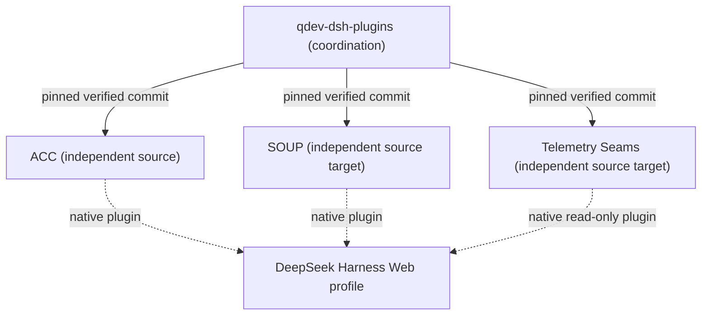

# Architecture

## Ownership model

**QDev DSH Plugins** is the coordination layer. Each plugin owns its code, build, tests, documentation, package identity, and release lifecycle. The parent owns the [overall backlog](BACKLOG.md), [general lessons](LESSONS.md), [component inventory](COMPONENTS.md), and cross-plugin verification.

The arrows describe **intended version ownership**, not current gitlink or runtime installation status. The integration workflow under [`.github/workflows/plugins.yml`](.github/workflows/plugins.yml) builds and verifies staged source without deploying it to QDev.

## Repository migration status

- **ACC:** independent canonical source exists at [dsh-auto-code-correct](https://github.com/l00p3rl00p/dsh-auto-code-correct).
- **SOUP:** native source lives in the [Scratchpad SOUP directory](https://github.com/l00p3rl00p/quatrus-scratchpad/tree/main/plugins/qdev-soup-drift).
- **Telemetry Seams:** native source lives in the [Scratchpad Telemetry directory](https://github.com/l00p3rl00p/quatrus-scratchpad/tree/main/plugins/dsh-telemetry-seams).
- All three directories on this transfer branch are **source copies**, not Git submodules yet. The target is three genuine Git submodule links to independent repositories.

## Isolation boundaries

Each plugin has its own version, package, unit tests, integration hooks, and recovery command. Parent-level coordination must not change installed plugin configuration, the DeepSeek source, or live QDev environment. Telemetry Seams observes and probes; it does not own the OTEL transport.

## Evidence model

Distinguish package installation, Host activation, browser slot registration, visible button, executed action, persisted configuration, and verified session behavior. These are different claims. See [Lessons](LESSONS.md) and [Runbook](RUNBOOK.md).
