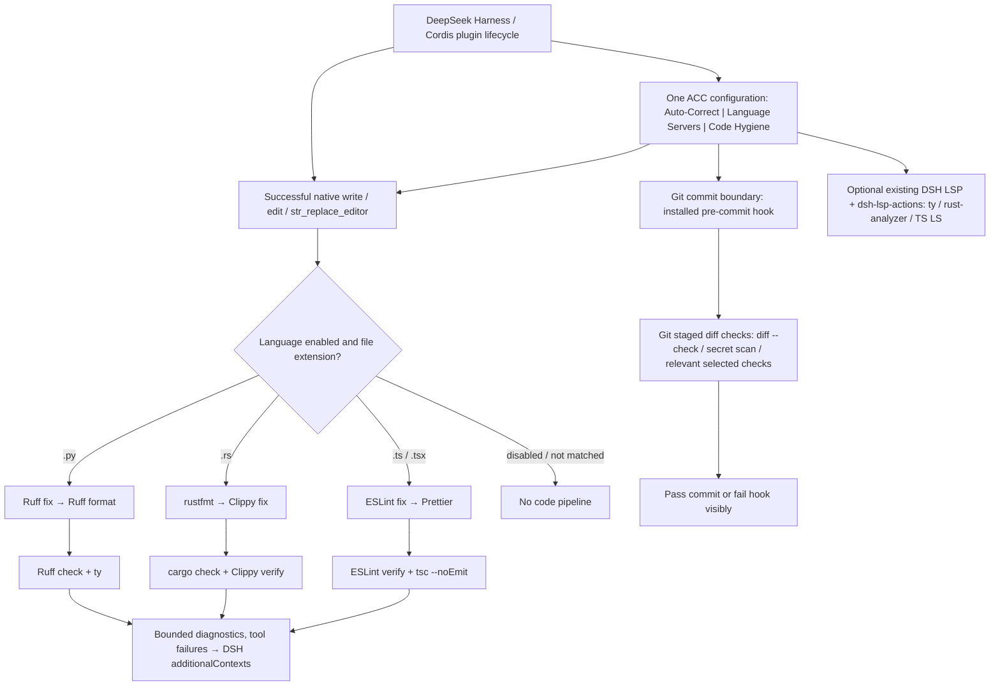

# ACC — Architecture

**Authority:** Behavior is implemented in `src/`; native registration and defaults are in `cordis.patch.yml`, package and version constraints in `package.json`. This document explains those artifacts and must not override them.

## Integration

The native implementation is in `src/index.ts`. ACC executes in the `tools/execute` waterfall after a successful eligible edit and uses `tools/post-execute` only to attach remaining diagnostics as model-visible `additionalContexts`. It uses the harness `ctx.subprocess` provider and appends a versioned ACC-owned `auto-code-correct/operation` Session event for each actual completed correction/check batch; it does not mutate the owning tool result. `src/readiness-service.ts` projects the same read-only executable/project preflight through the native Typert Gateway. The Web half declares `dsh.client.immediately: true`, mounts that Remote contract, and declares `uiConversation` alongside `slots`, `configForms`, and `remote`; Cordis exposes only declared Client services.

**The old `hooks.json` and `check.sh` are superseded legacy experiments, not the installation method.** Do not install the third-party `dsh-plugin-hooks` for ACC.

## Execution

For successful native `write`, `edit`, and `str_replace_editor` operations, ACC resolves the actual path from the tool result (falling back to `file_path`), runs matching configured fixers in order, then runs read-only verifiers concurrently. Python defaults use Ruff fix, Ruff format, Ruff check, and ty; Rust defaults use rustfmt; shell defaults use ShellCheck. Commands are invoked without shell interpretation.

## Reused LSP actions and QDev toolchain

ACC uses the existing Apache-2.0 [dsh-lsp-actions](https://github.com/PerryLink/dsh-lsp-actions) at caret range `^0.5.17` as an ordinary package dependency (the exact resolved version is recorded in `pnpm-lock.yaml`, not in `package.json`). **It is one generic plugin for multiple language servers**, not one TypeScript-only language server. ACC uses its native Cordis registration instead of copying its LSP client. The provider supplies diagnostics, formatting, code actions, completion, symbols, inlay hints, signature help, and rename. DSH's own `dsh-lsp`/`dsh-lsp-stdio`/`dsh-tool-lsp` keep their four read-only navigation operations.

| Language | Existing command | Arguments | File extensions |
|---|---|---|---|
| Python | `ty` | `server` | `.py` |
| Rust | `rust-analyzer` | none | `.rs` |
| TypeScript | `typescript-language-server` | `--stdio` | `.ts`, `.tsx` |

This is compatible with a deployment-provided Code-and-Quality toolchain mounted read-only at `<local-path>`, with `tools/bin` and `tools/rust/cargo/bin` on the Harness PATH. **Do not run installation scripts or attempt to write inside the mounted toolchain.** The plugin resolves existing executables first. No Python, Rust, or TypeScript language server is launched for a disabled language. Enabled servers start on demand when called, and are reused per workspace.

The upstream LSP-actions dependency has its own tests for TypeScript, routing, formatting, cancellation, and sandbox/permission handling. ACC's tests exercise upstream routing for all three languages and preserve the DSH tool registry's existing action definitions when already registered. The upstream project exposes subprocess and filesystem authority; it is not sandboxed on its own. Source/compatibility review does **not** replace a live Docker Harness integration test.

This dependency is version-pinned; it is not a fork and no upstream LSP source has been copied. The connected GitHub tooling in this session does not expose repository forking. Fork only if a demonstrated defect requires an approved downstream change.

## Default behavior and configuration choices

ACC runs only after successful configured file-edit tools, selected by extension:

- Python: Ruff fix, Ruff format, Ruff verification, ty.
- Rust: rustfmt, Clippy fix, cargo check, Clippy verification. Clippy fix is project-scoped and can modify additional files. Remove `clippy-fix` from the profile override to disable it.
- TypeScript/TSX: ESLint fix, Prettier format, ESLint verification, TypeScript compiler verification. ESLint and TypeScript project configuration must exist in the target workspace.
- Shell: ShellCheck verification.

The plugin does not launch language servers; they remain editor services. No unrelated language pipeline runs on an edit.

**Profile customization:** override the `auto-code-correct` row in the profile's `cordis.patch.yml`, restating its full `config` (DSH replaces whole config rows). The `fixers` and `checkers` arrays determine which operations run; remove entries to disable them. `tools` selects edit-tool names and `maxDiagnosticChars` caps agent-visible output.

## Current implementation boundary

The source now passes the local verification suite and the built tarball is installed and active in the `web` DSH profile. A full live agent edit/restart acceptance remains environment-dependent and has not been claimed here. The plugin processes one file path per edit-tool result; it does not batch across tool calls. Project root discovery is based on nearest Cargo.toml for Rust and nearest tsconfig.json or package.json for TypeScript. These behaviors still need end-to-end integration testing. Do not claim inaccessible files were corrected.

### Native Chat and Trajectory operation visibility

ACC defines a versioned operation payload with the parent call identity, file path, exact operation name and argv, timing, status (`clean`, `findings`, `failed`, `unavailable`, `timeout`, or `cancelled`), exit/signal facts, bounded output, and observed before/after text. ACC persists that payload in its own typed `auto-code-correct/operation` Session event, which is projected by the AutoCorrect tab. `tools/execute` still re-canonicalizes copied results and drops added metadata, and `tools/post-execute` has no metadata-patch decision; ACC therefore does not enrich the parent result or emit synthetic root tool/PTC events.

DSH `0.2.1-rc.5` does **not** expose a supported contribution seam that lets a plugin add children to the existing native edit Tool row in Chat or Trajectory. The shipped Chat and Trajectory tool definitions already claim `tool/result` for their targets, so another plugin definition cannot claim that same event without a target collision. The only existing nested-event vocabulary is PTC, whose events truthfully mean a model-visible `run_code` sub-dispatch and must not be repurposed for ACC automation. `tool.call.toolview` customizes rendering only after an existing tool lifecycle exists; it cannot create one. Replacing Trajectory is also non-conforming: its public extension surface provides only `conversation.trajectory.images`, not a row/presentation contribution, and disabling it would require duplicating its private assembly and renderer.

The smallest upstream-compatible completion seam is a generic `ToolRunContext.startOperation()`/settle API in `@deepseek-ai/dsh-tools`, backed by durable `tool/operation-start` and `tool/operation` events. The native Chat and Trajectory tool definitions should project those children under their real owning root call, use the supplied exact operation name rather than a generic “Tool call” label, and reuse their current status/timing/result/diff rendering. ACC would call that API around each subprocess and keep `meta.autoCodeCorrect` as its versioned detail/diff payload. This requires a writable, source-controlled DSH checkout and rebuild; it must not be patched into the installed package or faked from an ACC client plugin. Until that platform seam is released and installed, strict native nested-row acceptance is **PARTIAL**, not passed.

## Implementation contract — restored from ACC design decisions (2026-11-01)

**ACC is one native DSH plugin, with one persistent configuration and three independently controlled settings groups: Auto-Correct, Language Servers, and Code Hygiene.** The following is the intended behavior and acceptance contract; see the implementation-status table below for what the current source actually provides.

1. **One plugin, one configuration.** One ACC bundle owns the three settings groups; language and individual-capability controls are independent, with sane, inspectable defaults. Do not create separate Python, Rust, TypeScript, or Git-hygiene plugins.
2. **Native DeepSeek Harness only.** Use Cordis plugin registration/lifecycle, native `tools/execute` and `tools/post-execute`, the DSH subprocess provider, configuration forms/editor, conversation-view registration, and supported agent/tool interfaces. Do not patch DSH source or install the historical hook experiment.
3. **Real on/off behavior.** Disabled language means no pipeline; disabled fixer/checker means it is not run; disabled language server means it is not started. A UI toggle must correspond to the actual execution path, not merely change presentation.
4. **Automatic at the appropriate event.** After an eligible successful edit, select the matching language's correction and verification pipeline without making the agent remember a command. Before an eligible Git commit, run selected staged-change hygiene automatically **using the ACC-managed Git pre-commit hook installed automatically by the plugin (enabled by default)**. A manually invoked historical secret scan stays manual.
5. **No redundant pipelines.** A Python edit must not launch Rust or TypeScript checks. Only enabled matching capabilities run; Git-boundary hygiene is not rerun after every edit. Reuse installed tools, existing LSP implementations and Git tooling.
6. **Visible failure semantics.** Stop subsequent mutating fixers on a fixer failure; report failure and unresolved diagnostics to the agent using the current DSH result/context channel. Never mark a failed checker as clean. Preserve the original tool outcome and admission/cancellation semantics. Do not claim a failed tool edit succeeded.
7. **Persistent settings.** Native DSH profile configuration and ConfigForms/editor changes must survive restart and actually govern the plugin after reload. CLI tool ownership records live in their separate ACC state ledger, not the settings source of truth.
8. **Verifiable package.** GitHub Actions must build the installable package and test loading the native plugin, the three settings groups and their enable/disable effects, pipeline gating, Git hygiene and persisted behavior. A passing CI build is not proof of a live Docker Harness installation.
9. **No upstream patching or extra integration code without approval.** Audit existing native capabilities first. Reuse the actual code-quality installation; avoid unapproved Docker service additions or parallel linters.

### Two-event architecture

The diagram is a **design and existing-seam map**, not a claim that every arrow is operational by default. The normal DSH post-edit path exists. Git checks are implemented in `src/cli.ts`; ACC automatically installs/chains its native pre-commit hook on plugin activation when inside a repository and when an edited repository is discovered. The native `hygieneEnabled` master switch is on by default, and disabling it makes the installed hook a no-op. Existing hooks and `core.hooksPath` are preserved. The LSP branch runs independently from edit-time fix/verify.

### Language-specific post-edit pipeline — exact intended sequence

| Edited file | Sequential mutating correction (stop later mutations if one fails) | Read-only verification after correction (may run concurrently) | Source |
|---|---|---|---|
| Python `.py` | `ruff check --fix {file}` → `ruff format {file}` | `ruff check {file}` + `ty check {file}` | `cordis.patch.yml` |
| Rust `.rs` | `rustfmt --edition 2021 {file}` → `cargo clippy --fix --allow-dirty --allow-staged -- -D warnings` | `cargo check` + `cargo clippy -- -D warnings` | `cordis.patch.yml` |
| TypeScript `.ts`, `.tsx` | `eslint --fix {file}` → `prettier --write {file}` | `eslint {file}` + `tsc --noEmit` | `cordis.patch.yml` |

Rust project-scoped Clippy fixes can modify **other** files and are potentially disruptive in a shared tree; the user-approved config decides whether to enable them. The plugin's default language masters are **Python enabled, Rust and TypeScript disabled**, so the table describes their configured pipelines **when enabled**, not a claim all three run on install. Existing config also includes a `shellcheck` checker for `.sh`, but the current `languageForExtension` path admits only Python/Rust/TypeScript; ShellCheck belongs to explicit Git hygiene (or requires an approved implementation change to run post-edit). Do not promise automatic post-edit ShellCheck until verified.

### Git-related checks — same ACC, different event

| Event | Intended checks | Actual implementation and exact source |
|---|---|---|
| **After successful code edit** | Language-specific fix, format and type/lint verification plus durable operation metadata | `src/index.ts` on DSH `tools/execute`; `tool/result.meta.autoCodeCorrect`; `cordis.patch.yml` |
| **Before Git commit** | `git diff --cached --check`, staged Gitleaks scanning and staged ShellCheck **on by default**; optional large-file and audit checks | `src/hygiene-hook.ts` installs/chains a Git-native pre-commit hook on ACC activation/edit, and `src/cli.ts` executes the configured checks |
| **Manual / CI boundaries** | `npm audit --audit-level=high`, `license-checker --summary`, full Git history Gitleaks scan, GitHub Actions verification | `src/cli.ts`, `.github/workflows/ci.yml`; selected optional checks must be explicitly enabled/invoked |

The Git hook invokes the ACC CLI in the Git repository, not a separate DSH event API. Its effective hygiene configuration is generated by `src/hygiene-hook.ts` from the native DSH profile's `hygieneEnabled` and `capabilities` fields into `<git-dir>/acc-hygiene-effective.json`; `src/cli.ts` reads that generated projection. Defaults are `git-diff`, `gitleaks`, `shellcheck` (not `large-files`). This generated file is runtime state, not an independently editable authority. Hook regeneration happens on plugin activation when in a repository and after successful DSH edits; verify profile-setting updates are reflected before relying on a hook after a settings change without another edit.

### Three settings groups and current delivery status

| Group | Current source | Delivered | Still requiring proof or reconciliation |
|---|---|---|---|
| **Auto-Correct** | `src/index.ts`, `src/operation-record.ts`, `cordis.patch.yml`, `src/capabilities.ts` | Cordis execute/post-execute pipeline, language/capability gating, ordered fixers, parallel read-only checks, durable named operation metadata, model-visible findings | Live installed DSH verification; exact tools and Git changes at real runtime; default only Python enabled |
| **Language Servers** | `src/index.ts`, `src/client/index.tsx`, `dsh-lsp-actions` dependency | Language and language-server gates, existing DSH LSP stdio/provider integration, reuse rather than separate LSP engine | Live DSH startup and shutdown/reload behavior in each language; persistence across restart |
| **Code Hygiene** | `src/hygiene-hook.ts`, `src/cli.ts`, `src/client/index.tsx` | Default-on Git pre-commit hook with Gitleaks, ShellCheck and Git staged diff check, DSH-native settings projected to Git runtime policy; existing hook chaining | Real DSH reload/profile persistence and host-versus-Docker execution still require live proof |
| **Packaging and verification** | `package.json`, `.github/workflows/ci.yml`, `test/` | Build/typecheck/lint/tests/pack/install-profile steps declared; test files cover admission/config/discovery/LSP | Confirm the actual workflow results and add explicit whole-contract tests for three groups, on/off, Git hook and settings persistence |

The current code runs verification even after a mutating fixer fails, and returns those findings; it does **not** proceed to further mutating fixers. A checker failure is reported as a finding; ACC does not itself turn the original successful edit into a blocked tool execution. That distinction is intentional and must be tested against the desired visibility contract.

### Boundaries and authoritative implementation links

- `src/index.ts`: execute/post-edit pipeline admission, subprocesses, durable operation metadata, diagnostics injection and LSP integration.
- `src/operation-record.ts`: versioned `tool/result.meta.autoCodeCorrect` schema and untrusted-payload validator.
- `src/client/index.tsx`: three-group configuration UI and AutoCorrect view registration via native DSH conversation slots.
- `src/client/autocorrect-view.tsx`: session-scoped AutoCorrect tab showing completed operations, outcomes, timings, output and observed changes.
- `src/capabilities.ts`: canonical capability IDs and per-language grouping.
- `src/cli.ts`: Git hygiene commands, pre-commit hook, ownership ledger and tool-manager CLI.
- `src/commands.ts`: DSH `/acc` human command.
- `cordis.patch.yml`: currently configured fixer/checker command argv and language defaults.
- `package.json`: packaged plugin, dependencies, build and verification commands.
- `.github/workflows/dsh-auto-code-correct-package.yml`: repository-root packaging workflow; builds, clean-profile installs, and uploads the versioned installable tarball.
- `.github/workflows/ci.yml`: package-local CI definition for standalone extraction.

## Web-client dependency and safety boundary

The ACC Web client is emitted by `tsdown.config.ts` for `window.__ModuleLoader__.load`. DSH's browser module loader is **not** Node's module resolver: an npm package inside the Docker container is not automatically importable by the browser. The supported runtime externals must match the real target Web loader. The readiness remote client uses the *pure runtime JS leaf* of the published `@deepseek-ai/dsh-typert-protocol/remote-info` package, which must be bundled into `lib/client.js` rather than emitted as an unsupported `require()`. In rc.5, ordinary subpath imports remained external despite `tsdown` configuration; `src/typert.remote-client.ts` therefore references the installed dependency's JS leaf directly (while retaining native Typert semantics and types). `tsdown.config.ts` defines the Web bundle; `scripts/check-package.mjs` rejects external CJS imports other than verified loader-provided modules and smoke-executes the generated client factory under a guarded ModuleLoader. The release GitHub Action invokes that guard through `pnpm run verify` **before** packing.

This is a deterministic static browser-dependency guard, not a substitute for exercising the plugin in a real DSH Web runtime. Host registration, browser client mount, native settings readiness, session operation evidence, and CLI escape/recovery have independent acceptance evidence. Keep plugin removal possible from `dsh plugin --profile web remove <name>` even if the Web UI cannot boot. A manually configured Cordis patch insertion may require a separate targeted removal. The shared rules are a private source repository and the exact operator procedure is in [RUNBOOK.md](RUNBOOK.md#emergency-recovery--bad-web-plugin).

> **Superseded 2026-11-11 (ACC 0.1.13):** the Typert readiness remote described below was removed. The client no longer mounts a remote; tool availability is reported by `/acc status`.

### Readiness Remote ownership and scoped consumption (ACC 0.1.9)

The browser client mounts the generated-equivalent `TYPERT_REMOTE` descriptor on `ctx.remote.$mount(TYPERT_REMOTE)`. The resulting `remote.accReadiness` is a **newly provided Cordis service**; it must not be consumed from the mounting fiber's `ctx.remote`. Instead, the browser UI registers its settings/config view and live readiness loader through a child `ctx.inject(['slots', 'configForms', 'uiConversation', 'remote.accReadiness'], (scope) => ...)` callback, where `scope.remote.accReadiness.snapshot` is permitted. Adding `remote.accReadiness` to the parent exported `inject` creates a circular wait. See [upstream DSH documentation discussion](https://github.com/deepseek-ai/deepseek-harness/discussions/4681). `scripts/check-package.mjs` guards the source contract; real deployed Web-profile UI readiness/Refresh is a separate acceptance test.

## Documentation authority

- **Authoritative executable configuration, not another Markdown document:** [package.json](package.json) (scripts, versions, dependencies, bundle manifest), [cordis.patch.yml](cordis.patch.yml) (native Cordis registration/default settings), and source code under `src/`. If prose disagrees with actual configuration or source, correct the prose; do not introduce a parallel version matrix.

Do not create new Markdown files for routine decisions or experiments: revise the correct existing authority. Preserve older experimental `hooks.json` and `check.sh` as legacy only; they are not installation interfaces.

## Behavior at a glance

ACC has **one plugin with three groups**: **Auto-Correct**, **Language Servers**, and **Code Hygiene**. After an enabled successful code edit it automatically runs the matching Python, Rust or TypeScript correction-and-verification pipeline and surfaces remaining diagnostics to the agent. Language servers use native DSH/LSP extensions and respect on/off switches. Git hygiene runs **at the Git boundary**, not after each edit, and is enabled by default: ACC creates/chains the native pre-commit hook for repositories it edits. Disable it with `hygieneEnabled: false` in the DSH plugin settings.

The complete [implementation contract, architecture diagrams, language matrix and known delivery gaps](ARCHITECTURE.md#implementation-contract--restored-from-acc-design-decisions-2026-11-01) are in `ARCHITECTURE.md`. The [two-event verification procedure](RUNBOOK.md#two-independent-event-acceptance-tests) is in `RUNBOOK.md`; exact setting/file flags are in `ENVIRONMENT.md`. The native DSH profile is the configuration authority; a generated policy in the repository Git directory supplies the same effective toggles to the Git hook. Live Docker/profile-restart verification is still required.

2026-11-11 — ACC removed its obsolete Typert readiness remote because it gated native options and conversation UI registration; `/acc status` remains the native tool-availability interface. Clean-container acceptance is pending.
